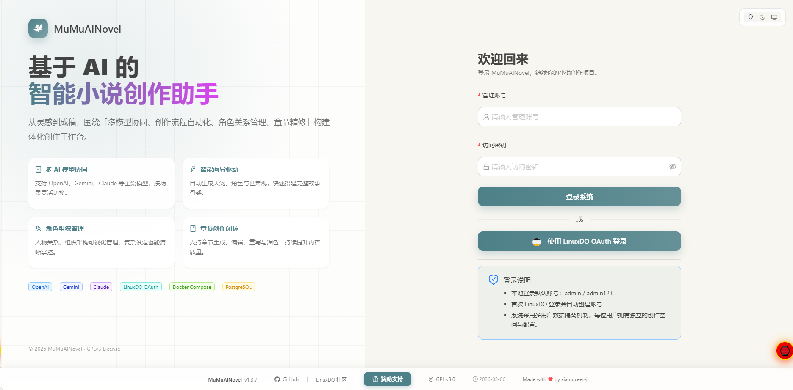
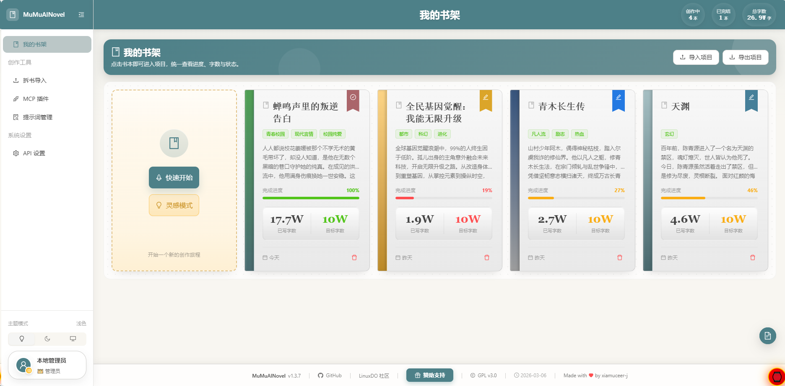
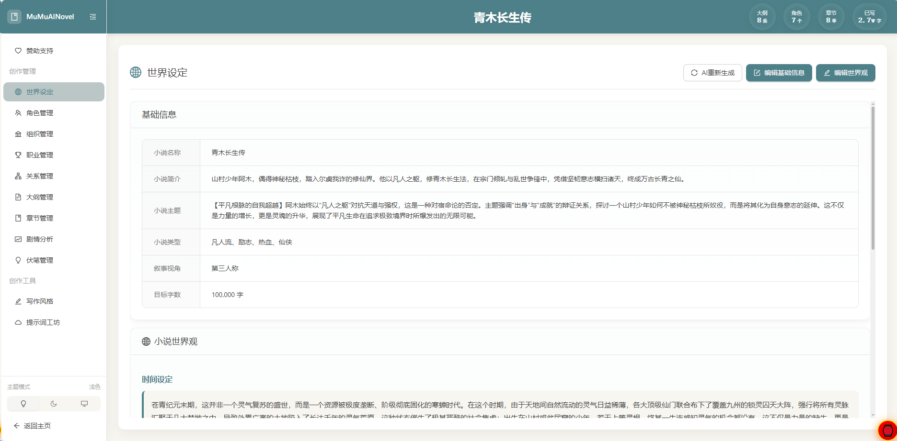
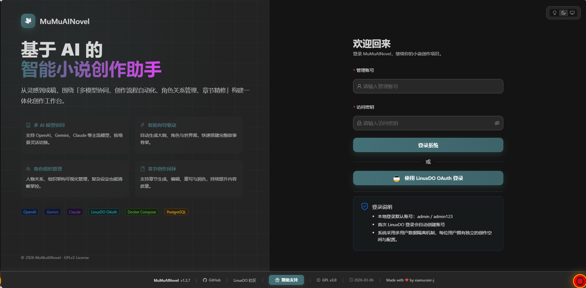
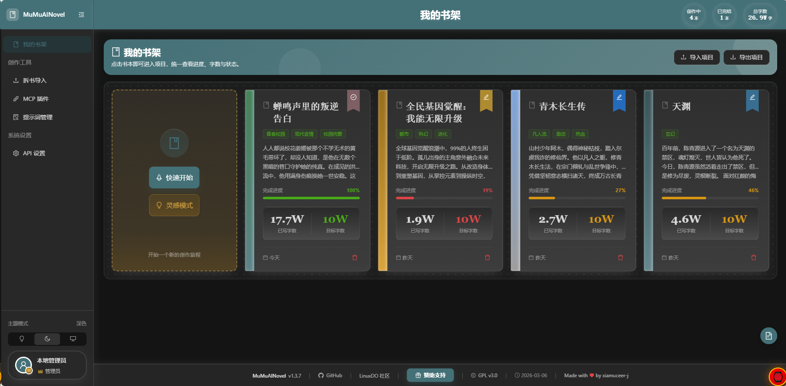
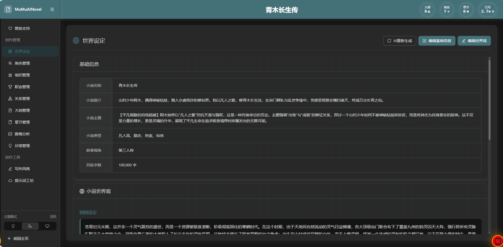

# AIFictionForge (灵创) 📚✨

<div align="center">

**[中文](/README.zh-CN.md) | English**

**An AI-powered intelligent novel creation assistant**

[Features](#-features) • [Model Requirements](#-model-requirements) • [Quick Start](#-quick-start) • [Configuration](#%EF%B8%8F-configuration) • [Project Structure](#-project-structure)

</div>

---

> This project is forked from [xiamuceer-j/MuMuAINovel](https://github.com/xiamuceer-j/MuMuAINovel).
> It is a localized, de-upstreamed derivative built on the upstream source, not an original standalone project.
> Thanks to the original author and all contributors. The code is licensed under GPL-3.0, see [LICENSE](LICENSE).

---

> **⚠️ Breaking change** (after `v1.5.5`): **PostgreSQL and Docker deployments are no longer supported.** SQLite is the only database, and the Docker / Docker Compose path has been removed. If you deployed with PostgreSQL or Docker, stay on `v1.5.5` or export your data yourself before upgrading; new installs run locally or use the single-port build on port 8008.

---

## 🧠 Model Requirements

| Context window | Status |
|---|---|
| >= 900,000 tokens | ✅ Supported |
| Measured below the floor | ❌ Rejected on save, and on every request that would dispatch that model |
| Probe could not reach a verdict | ❌ Also rejected: unknown counts as unqualified, until you declare `context_window_tokens >= 900,000` |

- Every AI feature requires a backing model with a context window of **at least 900,000 tokens**. Below that floor the model is refused when you save it and on every request that would dispatch it.
- There is **no implicit fallback model** and no tiered "128K mode". A fresh install has no usable AI model until you add one in **Settings**, where its window is probed against your own endpoint.
- `DEFAULT_MODEL` is retired and no longer read by the backend. Configure the model per account in the app.
- For how the window is measured, and the blind spots the probe still has, see [docs/model-requirements.md](docs/model-requirements.md).

> **Blind spot 1: a silent-truncating gateway can pass.** Compatibility relays often do not error on an oversized request, they just cut it down; such an endpoint answers the probe as if it accepted the scale and is recorded as qualified. The needle tier (tier 3) is not wired up in this iteration, so nothing separates "the endpoint accepted the request" from "the model really read the window". If output quality is worse than the reported window suggests, suspect the gateway, not the model name.

> **Blind spot 2: a stale verdict is never re-checked.** Verdicts are cached per (provider, base URL, model name) triple and are not refreshed automatically — not on a UTC schedule, not on dispatch. Requests keep being admitted under the stale verdict, and a gateway-side downgrade stays invisible, until you change one of the three triple parts or run the manual Re-check.

> **What even a correct verdict cannot tell you**: accepting the probe scale is not the same as using the window well. Long-range consistency in the middle of a novel stays a per-model property, so judge a new model on your own text before committing to it.

> **What this page does not claim**: supporting an API protocol is not the same as meeting the window requirement — the SDKs listed under Tech Stack describe transport compatibility only. Nor is it true that the floor can never be bypassed: a silent-truncating relay or a stale verdict can still admit a smaller window, which is why the blind spots above are written down.

---

## ✨ Features

- 🤖 **Multiple AI providers**: OpenAI, Gemini, Claude, and any OpenAI-compatible endpoint (protocol compatibility only; the model you configure still needs a >=900,000 token window).
- 🧙 **Project creation wizard**: AI generates the outline, characters, and world settings from a short brief.
- 📖 **Chapter workflow**: create, edit, regenerate (whole chapter or partial), and polish chapters, with configurable target length.
- 📚 **Book deconstruction**: import an existing text and analyze it chapter by chapter.
- 🧵 **Foreshadowing tracking**: track plot threads, get reminders about unrecovered ones, and view a foreshadowing timeline.
- 👥 **Characters and organizations**: character and organization management, a relationship graph, and customizable careers/ranks (cultivation realms, magic levels, and so on).
- 🌐 **Worldbuilding**: build out story backgrounds and settings.
- 💡 **Inspiration mode**: generate creative ideas and directions.
- ✍️ **Custom writing styles**: define and reuse your own AI writing styles.
- 🧩 **Prompt template editing**: visually edit prompt templates in the UI.
- 🧠 **Story memory and consistency**: long-term story memories per project, plus a data-consistency check and repair.
- 🛠️ **Skills and MCP plugins**: bundled writing skills (scan, analyze, write, deslop) and MCP plugin management.
- 🧭 **Plan runner**: approve a multi-step plan, then the server runs it. See [plan runner semantics](docs/plan-runner-semantics.md).
- 🔍 **Memory search**: semantic search across a project's story memories.
- 🌍 **Internationalization**: zh/en UI, with `content_language` controlling the language of AI output.
- 🔐 **Login**: local account or LinuxDO OAuth (with automatic account creation).
- 📦 **Import / export**: project data plus character and organization cards, for cross-project sharing.
- 💾 **Deployment**: a single-port build served by the backend on 8008, with SQLite as the only database.

## 📸 Project Preview

<details>
<summary>Multiple images ahead</summary>

| Login | Main interface | Project management |
|:--:|:--:|:--:|
|  |  |  |
|  |  |  |

</details>

## 💻 Hardware Requirements

| Setup | CPU | Memory | Storage | Network |
|------|------|------|------|------|
| Minimum (personal / development) | 2 cores | 2 GB RAM | 10 GB free | Stable internet for AI API calls |
| Recommended (small team / production) | 4 cores | 8 GB RAM | 20 GB SSD | Stable internet |
| High concurrency (80-150 users) | 8 cores | 16 GB RAM | 50 GB+ SSD | High bandwidth |

> **📌 Notes**
> - **Embedding model**: about 400 MB of disk space, loaded into memory at runtime.
> - No local GPU is required; the project depends on external AI APIs.

## 🚀 Quick Start

**Prerequisites**: Python 3.12 and Node.js (for the frontend), plus at least one AI service API key (OpenAI / Gemini / Claude / any OpenAI-compatible relay) for a model with a >=900,000 token context window. No external database is required: data lives in a local SQLite file.

### Clone and Configure

```bash
git clone https://github.com/andyhsu6/AIFictionForge.git && cd AIFictionForge
cp backend/.env.example .env          # then fill in the required config
```

Data is stored in `backend/data/mumuai_novel.db` (SQLite, created on first startup) — there is no database server to install and no migration step to run by hand.

Shortest path from here: `./aistoryforge.sh start` (backend on 8008, frontend dev server on 5173; `./aistoryforge.sh status` / `stop` / `restart`).

### Local Development / Building from Source

Prepare the embedding model first (about 400 MB, under `backend/embedding/models--sentence-transformers--paraphrase-multilingual-MiniLM-L12-v2/`). It is downloaded automatically from Hugging Face on first startup, or you can fetch it manually from <https://huggingface.co/sentence-transformers/paraphrase-multilingual-MiniLM-L12-v2>.

```bash
# Backend — run from the repository root, so that `.env` and the SQLite file resolve there
python -m venv backend/.venv && source backend/.venv/bin/activate   # Windows: backend\.venv\Scripts\activate
pip install -r backend/requirements.txt
cp backend/.env.example .env      # then edit; pydantic reads `.env` from the repo root
PYTHONPATH=backend python -m uvicorn app.main:app --host localhost --port 8008 --reload

# Frontend
cd frontend
npm install
npm run dev    # development mode
npm run build  # production build
```

If you leave `DATABASE_URL` unset the backend uses `backend/data/mumuai_novel.db`; set it only to point at another SQLite file (`sqlite+aiosqlite:///<path>`).

> **📌 Ports**: the frontend dev server runs on **5173** (Vite, proxying `/api` and `/generated-assets` to `http://localhost:8008`); the backend listens on **8008**. After `npm run build`, the built frontend is served by the backend as a single-port entry on **8008**.

## ⚙️ Configuration

Required in `.env` (`DATABASE_URL` is optional — see above, the built-in SQLite default is used when it is unset):

```bash
OPENAI_API_KEY=your_openai_key
OPENAI_BASE_URL=https://api.openai.com/v1
DEFAULT_AI_PROVIDER=openai
LOCAL_AUTH_ENABLED=true
LOCAL_AUTH_USERNAME=admin
LOCAL_AUTH_PASSWORD=your_password
# DEFAULT_MODEL is retired: the backend no longer reads it and there is no system
# default. Configure a >=900,000 token model per account in the app (Settings).
```

Any OpenAI-compatible relay works: point `OPENAI_BASE_URL` at the relay and set its key as `OPENAI_API_KEY`. See [`backend/.env.example`](backend/.env.example) for the full list, including the Xiaomi MiMo adapter.

Useful optional keys:

```bash
LINUXDO_CLIENT_ID=your_client_id             # LinuxDO OAuth
LINUXDO_CLIENT_SECRET=your_client_secret
LINUXDO_REDIRECT_URI=http://localhost:8008/api/auth/callback
LINUXDO_PROXY_URL=http://127.0.0.1:7890      # OAuth-only proxy
AGENT_PLAN_STEP_GRACE_SECONDS=3              # plan runner step delay
SESSION_COOKIE_SECURE=true                   # set false for plain-HTTP login cookies
# ALLOW_PRIVATE_AI_ENDPOINTS=true            # local / private-network LLM
# ALLOWED_AI_HOSTS=host.docker.internal,127.0.0.1
```

> **📌 Notes**: keep `SESSION_COOKIE_SECURE=true` on HTTPS (set `false` on HTTP if the browser does not persist the login cookie). If only LinuxDO login is unreachable, set `LINUXDO_PROXY_URL` rather than a global `HTTP_PROXY` / `HTTPS_PROXY`; it does not affect AI, SMTP, or database calls. Local and private-network LLM endpoints (e.g. Ollama, llama.cpp) are blocked by default (SSRF protection); enable them with `ALLOW_PRIVATE_AI_ENDPOINTS=true` or allowlist the host in `ALLOWED_AI_HOSTS`. Link-local addresses stay blocked.

## 📁 Project Structure

```
AIFictionForge/
├── backend/                 # FastAPI service
│   ├── app/                # api/, models/, services/, skills/, middleware/
│   ├── embedding/          # Embedding model files
│   └── requirements.txt
├── frontend/               # React + TypeScript app
│   ├── src/                # pages/, components/, services/, store/
│   └── package.json
├── docs/                   # Documentation
└── README.md
```

## 🛠️ Tech Stack

**Backend**: FastAPI • SQLite • SQLAlchemy • OpenAI / Claude / Gemini SDK

**Frontend**: React 18 • TypeScript • Ant Design • Zustand • Vite

## 📖 Usage Guide

1. **Sign in** with a local account or a LinuxDO account.
2. **Create a project**, using "Create with Wizard" to have the AI draft the outline, characters, and world settings.
3. **Refine the setting**: manage characters, organizations, relationships, careers/ranks, and worldbuilding.
4. **Generate and edit chapters**, regenerate or polish them, and set a target length.
5. **Analyze**: run book deconstruction, chapter analysis, and consistency checks; track foreshadowing.
6. **Extend**: install writing skills, connect MCP plugins, or approve a multi-step plan for the agent runner.

### API Documentation

- Swagger UI: `http://localhost:8008/docs`
- ReDoc: `http://localhost:8008/redoc`

## 📝 License

This project is licensed under the [GNU General Public License v3.0](LICENSE).

**What GPL v3 means:** free to use, modify, and distribute; usable for commercial purposes; modified and derivative versions must stay open source under GPL v3 and preserve the original author's copyright.

## 🙏 Acknowledgments

- Upstream project [xiamuceer-j/MuMuAINovel](https://github.com/xiamuceer-j/MuMuAINovel) and all its contributors
- [FastAPI](https://fastapi.tiangolo.com/) - Python web framework
- [React](https://react.dev/) - Frontend framework
- [Ant Design](https://ant.design/) - UI component library
- [SQLite](https://www.sqlite.org/) - Database

## 📚 More Docs

- [CONTRIBUTING.md](CONTRIBUTING.md) - how to contribute
- [docs/i18n.md](docs/i18n.md) - internationalization guide
- [docs/model-requirements.md](docs/model-requirements.md) - context-window measurement and blind spots
- [docs/plan-runner-semantics.md](docs/plan-runner-semantics.md) - plan runner concurrency, timing, interruption
